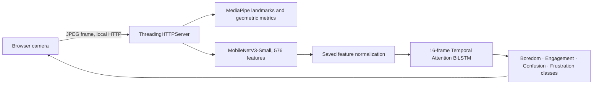

# SYNAPSENSE · NEUROCORE

**BEHAVIOURAL INTELLIGENCE FROM VISUAL CUES**

SYNAPSENSE is a research prototype that estimates four DAiSEE-labelled behavioural categories from sampled video frames. It combines a plain HTML/CSS/JavaScript browser interface with a Python inference service. The outputs are visual behavioural estimates; they are not clinical assessments, measurements of brain activity, or reliable measurements of a person's internal state.

## Current status

- The frontend is a static application in `app/`.
- The backend is Python's standard-library `ThreadingHTTPServer` in `src/inference/live_server.py`; it is not a FastAPI service.
- `HOST` and `PORT` configure the backend listener. Defaults preserve local use at `127.0.0.1:8000`; a hosted service can set `HOST=0.0.0.0` and its platform-provided `PORT`.
- The plain HTML/CSS/JavaScript frontend builds as a static Vercel site with `SYNAPSENSE_API_BASE_URL` set to the HTTPS backend origin.
- Model evaluation is limited: the champion's recorded validation Macro-F1 is **0.2982**. Treat this as experimental research performance, not a product accuracy guarantee.

## Research task and dataset

The implemented task uses the visual portion of DAiSEE and predicts four separate labels: **Boredom**, **Engagement**, **Confusion**, and **Frustration**. The project does not use audio and should not be described as audio-visual analysis.

The local recovery report records these usable labelled clip pairs:

| Split | Usable labelled clips |
| --- | ---: |
| Train | 5,357 |
| Validation | 1,429 |
| Test | 1,784 |
| **Total** | **8,570** |

The local recovery audit also records one missing or corrupt official training video. The counts above are usable labelled pairs, not a claim that every official source video was recovered. The original DAiSEE videos, extracted frames, and feature caches are excluded from this repository.

## Data preparation and features

The preprocessing code samples 16 frames per clip and resizes them for the ImageNet-pretrained MobileNetV3-Small feature extractor. Each frame yields a 576-dimensional visual vector. The live input is a rolling sequence of 16 such vectors, normalized with the saved training mean and standard deviation.

MediaPipe Face Landmarker also supplies 478-point facial landmarks. Eight geometric metrics (eye aspect ratios, mouth aspect ratio, face size proxies, and head-pose proxies) are shown for context when a face is detected. **These geometry metrics are not inputs to the classifier.** The live classifier uses the 576-dimensional MobileNetV3-Small features only.

## Champion model and evaluation

The champion is the **Temporal Attention BiLSTM** in `models/visual_attention/`:

- 16 time steps and 576 visual features per step
- One bidirectional LSTM layer with 128 hidden units per direction
- Temporal attention and four independent four-class output heads
- Class indices 0–3 are selected by each output head's argmax
- Recorded best validation Macro-F1: **0.2982** (epoch 6 in the training history)

The score is modest and does not establish generalization beyond the evaluated data. Predictions are experimental, ordinal class outputs; no confidence or calibrated probability is exposed. Additional comparison results and confusion matrices are retained in `models/` and summarized in [`docs/research-results.md`](docs/research-results.md).

## Architecture



The service routes are `GET /health`, `POST /api/session/start`, `POST /api/frame`, and `POST /api/session/stop`. It also serves the static application at `/`. Frames are posted as JPEG bytes with a session identifier header. There is no WebSocket transport. Session feature buffers are isolated by client-generated session ID, capped to 16 features each, limited by `MAX_SESSIONS` (default 8), and expire after `SESSION_TTL_SECONDS` (default 1800). Model inference is serialized by a process-wide lock to protect the shared CPU model and MediaPipe instance.

## Repository layout

```text
app/                      Static HTML, CSS, JavaScript, and emblem
configs/                  Sanitized example for local dataset recovery
docs/                     Sanitized research summary and GitHub file manifest
models/                   Champion inference assets and research metrics
reports/                  Safe historical implementation audit
src/data/                 Dataset auditing and manifest/recovery tools
src/features/             Facial metrics and feature preparation
src/inference/            Local browser/API inference service
src/preprocessing/        Frame and feature extraction
src/training/             Training and evaluation implementations
tests/                    Environment smoke test
```

## Local setup and run

The observed development environment uses Python 3.11. The pinned runtime set is in `requirements-production.txt`; test tooling is in `requirements-dev.txt`. These pins match the inspected working CPU environment. The target OCI operating system and CPU architecture still need clean-machine install validation before deployment.

From the repository root, create/activate a virtual environment and install the pinned runtime dependency set. Then start the local service:

```powershell
python -m venv .venv
.\.venv\Scripts\Activate.ps1
pip install -r requirements-production.txt
python src\inference\live_server.py
```

Open [http://127.0.0.1:8000](http://127.0.0.1:8000). The health endpoint is [http://127.0.0.1:8000/health](http://127.0.0.1:8000/health). The app waits for 16 captured frames before showing the first prediction; later predictions use a rolling window. Use **End session** to stop camera tracks and clear that session's in-memory feature buffer.

### Static frontend build and backend environment

`npm run build` copies the static files to `dist/` and writes `runtime-config.js` from `SYNAPSENSE_API_BASE_URL`. For Vercel, configure that variable to the backend HTTPS origin (for example `https://inference.example.com`, with no path), build command `npm run build`, and output directory `dist`. The source default keeps local development on `http://127.0.0.1:8000`; a deployed domain without the build variable reports the API as unconfigured. Browser camera permission requires HTTPS or localhost.

On the backend, set `HOST=0.0.0.0`, `PORT` to the platform port, and `CORS_ALLOWED_ORIGINS` to an exact comma-separated list, including the real Vercel production origin (for example `https://synapsense.example.com`). Add preview origins only when needed and as exact HTTPS origins. Wildcards are rejected. Local development origins are allowed by default. CORS is a browser policy, not authentication or abuse protection.

### MobileNetV3-Small pretrained weights

The backend calls `mobilenet_v3_small(weights=MobileNet_V3_Small_Weights.DEFAULT)`. TorchVision's official metadata points to `https://download.pytorch.org/models/mobilenet_v3_small-047dcff4.pth`; TorchVision checks the URL's `047dcff4` hash prefix while downloading. Startup also verifies the cached file against SHA-256 `047dcff4addef86ea5bc2eff13c9614dc11f47ab1160d0a71a25e7db994f4e1f`. A clean host downloads the weight on first startup if absent from `<torch.hub.get_dir()>/checkpoints/` (override its parent with `TORCH_HOME`). Subsequent starts reuse that cache. Startup exposes a download/load/integrity failure in `/health.model_error` and does not mark the model loaded. Provision outbound access to the official host or prewarm that cache on the target machine; do not add a duplicate copy to this repository.

## Privacy and data handling

Camera frames are transmitted from the browser to the configured inference server for live predictions. The server decodes and processes frame bytes in memory, retains only each session's rolling 16-feature window and does not implement recording or persistent frame storage. Session state expires after its TTL or is cleared when **End session** is used. The browser keeps prediction history in page memory; an exported JSON summary is generated locally only when requested. The camera can be stopped with **End session**. These statements describe this code's behavior; hosting-provider infrastructure and logs are outside the application's storage implementation and should be checked separately.

## Limitations and future work

- Validation Macro-F1 of 0.2982 is limited; predictions should not be interpreted as established or objective measurements of behaviour.
- The label classes are estimates from visual cues and do not diagnose boredom, engagement, confusion, frustration, fatigue, health, or neural activity.
- The eight facial geometry metrics are descriptive proxies and are not classifier inputs.
- Live capture timing differs from the prepared DAiSEE clips and can affect outputs.
- Public deployment still needs authentication, rate limiting, abuse controls, monitoring, and host-level privacy/logging review. CORS does not provide these protections.
- Frame inference is serialized; expect concurrent users to queue behind CPU inference. The default active-session cap is eight, but cloud throughput has not been benchmarked.
- Linux/ARM wheel availability, target cloud memory/performance, and a clean OCI installation have not yet been validated.

Planned follow-up includes validating the pinned dependencies on the selected OCI image and architecture and completing security and host-level privacy review before public use.
